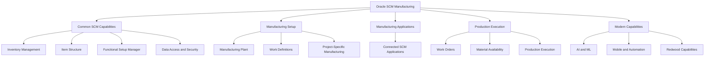
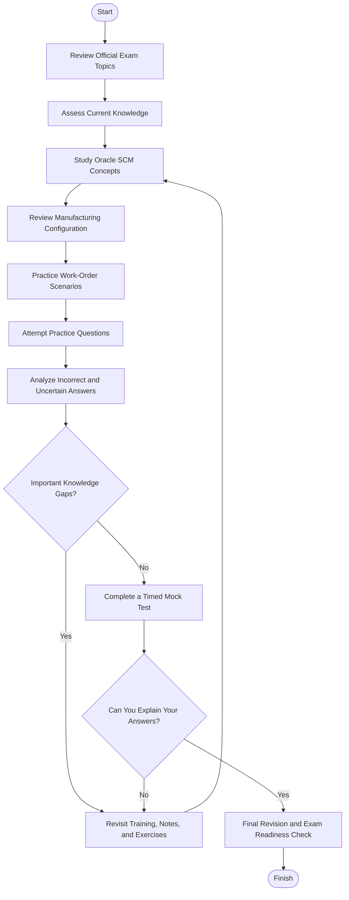
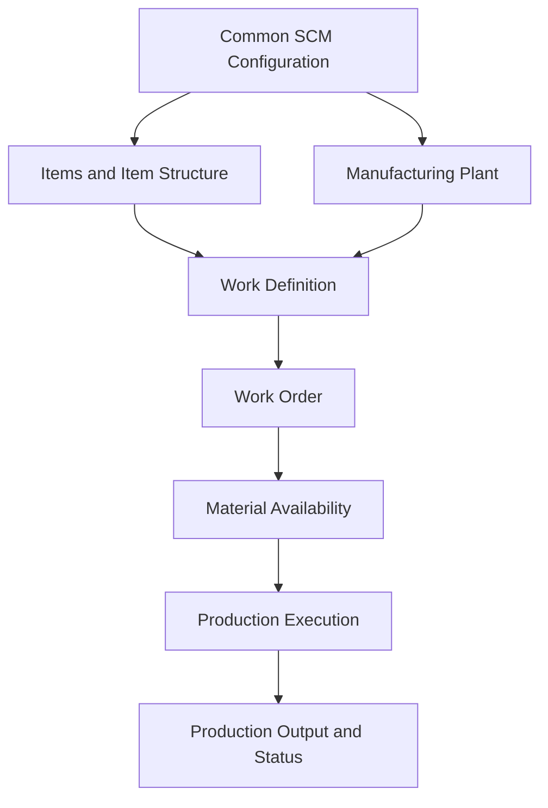
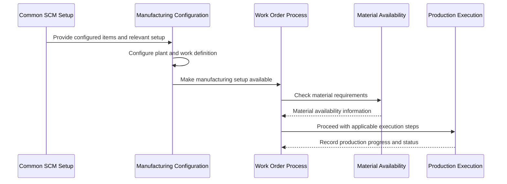
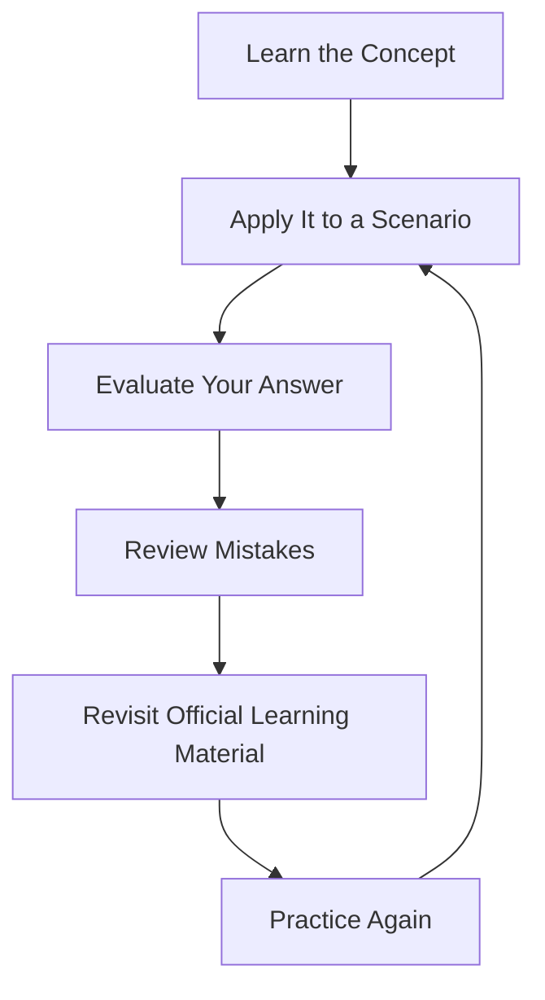
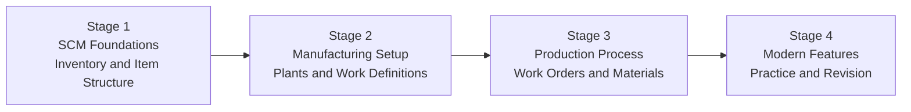

# Oracle Manufacturing Cloud 2026 Implementation Professional (1Z0-1075-26) — Study Guide

A practical, community-focused study guide for the **Oracle Manufacturing Cloud 2026 Implementation Professional (1Z0-1075-26)** certification. This repository helps learners organize their preparation around Oracle's published exam topics, understand manufacturing configuration in Oracle Fusion Cloud Supply Chain Management (SCM), and practice applying manufacturing concepts to realistic business scenarios.

The guide covers common supply chain capabilities, manufacturing setups, work definitions, work orders, material availability, production execution, and related capabilities such as AI/ML, mobile features, automation, and Redwood.

## Table of Contents

- [Overview](#overview)
- [About the Certification](#about-the-certification)
- [Who Should Prepare?](#who-should-prepare)
- [Official Exam Topics](#official-exam-topics)
- [Conceptual Skills Map](#conceptual-skills-map-not-official-weighting)
- [Certification Preparation Flowchart](#certification-preparation-flowchart)
- [Manufacturing Process Architecture](#manufacturing-process-architecture)
- [Manufacturing Execution Workflow](#manufacturing-execution-workflow)
- [Circular Study and Revision Cycle](#circular-study-and-revision-cycle)
- [Step-by-Step Preparation Guide](#step-by-step-preparation-guide)
- [Suggested Study Roadmap](#suggested-study-roadmap)
- [Practice Questions and Mock Tests](#practice-questions-and-mock-tests)
- [Hands-On Practice Projects](#hands-on-practice-projects)
- [Common Preparation Mistakes](#common-preparation-mistakes)
- [Career Relevance](#career-relevance)
- [Frequently Asked Questions](#frequently-asked-questions)
- [Official and Additional Resources](#official-and-additional-resources)
- [About CertsGate](#about-certsgate)
- [Disclaimer](#disclaimer)

## Overview

Manufacturing implementation involves more than configuring a production screen. Implementers need to understand how items, item structures, manufacturing plants, work definitions, work orders, materials, and production execution fit together.

The 1Z0-1075-26 exam focuses on implementing Oracle Manufacturing Cloud and related capabilities in the Oracle SCM environment. A useful preparation strategy combines official training with practical exercises and scenario-based reasoning.

This repository is designed to help candidates:

- Review the published exam topics in a structured way.
- Understand common Oracle SCM and Manufacturing concepts.
- Study manufacturing plants, work definitions, and production workflows.
- Connect material availability with work-order execution.
- Review security, common configuration, AI/ML, mobile, automation, and Redwood topics.
- Practice explaining configuration decisions instead of memorizing answers.
- Identify weak areas before taking a practice test.

## About the Certification

Oracle MyLearn identifies the exam as **Oracle Manufacturing Cloud 2026 Implementation Professional**, exam code **1Z0-1075-26**.

| Exam detail | Information |
|---|---|
| Certification provider | Oracle |
| Certification name | Oracle Manufacturing Cloud 2026 Implementation Professional |
| Exam code | 1Z0-1075-26 |
| Delivery | Proctored online |
| Format | Multiple-choice questions, including simple and scenario-based questions |
| Duration | 90 minutes |
| Number of questions | 50 |
| Passing score | 68% |
| Prerequisite | Oracle states that there is no prerequisite to take this exam |
| Official exam page | [Oracle MyLearn](https://mylearn.oracle.com/ou/exam/oracle-manufacturing-cloud-2026-implementation-professional-1z0-1075-26/107076/160635/268934) |
| Recommended learning path | [Become a Certified Manufacturing Implementer](https://learn.oracle.com/ols/learning-path/become-a-certified-manufacturing-implementer/57232/97468) |

*Exam details are based on the Oracle MyLearn listing available when this guide was prepared. Confirm current information before scheduling your exam.*

## Who Should Prepare?

This certification may be relevant to:

- Oracle SCM implementation consultants.
- Manufacturing functional consultants.
- Oracle Fusion Cloud SCM administrators.
- Supply chain and production-process specialists.
- Business analysts supporting manufacturing implementations.
- Professionals responsible for configuring manufacturing applications.
- Learners building a foundation in Oracle Cloud manufacturing processes.

Oracle describes the exam as intended for implementers, administrators, managers, and consultants who implement SCM Manufacturing solutions.

Familiarity with manufacturing terminology, inventory processes, item structures, and production operations can make preparation easier. Candidates new to Oracle Fusion Cloud should spend additional time understanding the wider SCM application and its configuration model.

## Official Exam Topics

Oracle MyLearn publishes the following topic areas for the exam. Use the official page to review the current wording and details.

### 1. Implementing Common Supply Chain Capabilities

**Explain key features and capabilities of Oracle Supply Chain Management**

- Understand the basics of Inventory Management.
- Explain the purpose of Item Structure.
- Describe the role of Functional Setup Manager.

**Configure Oracle Supply Chain Management**

- Manage Data Access and Security.
- Configure common objects.
- Manage Item Structure.

### 2. Implementing Manufacturing Setups

**Explain key features and capabilities of Oracle Manufacturing**

- Understand the fundamentals of Manufacturing.
- Understand the Project-Specific Manufacturing process.

**Configure Oracle Manufacturing**

- Configure Manufacturing Plant.
- Set up Work Definitions.

### 3. Implementing Applications That Enable Manufacturing

**Explain the key features and capabilities of Oracle Supply Chain Applications for Manufacturing**

- Understand the role of Oracle Supply Chain Applications in Manufacturing.

### 4. Executing Production with Manufacturing

**Explain key features and capabilities of Work Orders in Manufacturing**

- Understand the fundamentals of Work Orders.

**Execute Work Orders in Manufacturing**

- Execute Work Orders.
- Manage Material Availability.
- Execute Production.

### 5. Leveraging AI/ML/Mobile and Automation Features

Study how AI/ML, mobile capabilities, and automation can streamline manufacturing processes and support operational efficiency. Use Oracle's current training content to determine the relevant features and their behavior.

### 6. Enabling Redwood Capabilities

Understand how to enable Redwood capabilities and assess their implications for existing configurations. Review the corresponding Oracle training material for the current application experience and setup requirements.

**Source:** [Official 1Z0-1075-26 Exam Topics](https://mylearn.oracle.com/ou/exam/oracle-manufacturing-cloud-2026-implementation-professional-1z0-1075-26/107076/160635/268934)

## Conceptual Skills Map (Not Official Exam Weighting)

The following diagram groups related learning topics to help organize study sessions. It is an independent study overview, **not an official exam domain chart**. Oracle's published exam page should be used for the authoritative objectives.

There is no numerical weighting in this diagram because verified official percentages are not included here. Prioritize study using the current Oracle exam topics and your own assessment of weak areas.

## Certification Preparation Flowchart

Use a structured process instead of moving directly from reading to repeated question attempts.

A mock-test score is only one signal. You should also be able to explain configuration choices, understand manufacturing workflows, and identify why alternative answers do not meet the requirements in a scenario.

## Manufacturing Process Architecture

The following diagram is a simplified, illustrative view of how common manufacturing concepts relate. It is not a representation of a specific customer's implementation or a complete Oracle application architecture.

### What to understand in this workflow

- **Common SCM configuration:** Shared application setup, data access, security, and common objects provide the wider configuration context.
- **Items and item structure:** Understand how item information and product structure relate to manufacturing.
- **Manufacturing plant:** Learn its role in manufacturing configuration and operations.
- **Work definition:** Study how manufacturing work is defined and how that setup relates to production.
- **Work order:** Understand the purpose of a work order and its place in production execution.
- **Material availability:** Consider whether required materials are available for the planned production activity.
- **Production execution:** Understand the process of executing work and recording production activity.

Use the official Oracle course and documentation to verify the exact application behavior and configuration steps.

## Manufacturing Execution Workflow

A scenario-based view helps connect manufacturing setup with the operational process.

This is a conceptual study diagram, not a claim about every Oracle workflow, integration, or system event. Actual behavior depends on application configuration, process design, and the relevant Oracle functionality.

## Circular Study and Revision Cycle

Manufacturing concepts often become clearer when you revisit them through questions and exercises. Use the following cycle throughout preparation.

For example, after studying work definitions, try to explain how manufacturing setup relates to a work order. If you cannot explain the relationship clearly, return to the relevant lesson before moving on.

## Step-by-Step Preparation Guide

### Step 1: Start with Oracle MyLearn

Open the [official exam page](https://mylearn.oracle.com/ou/exam/oracle-manufacturing-cloud-2026-implementation-professional-1z0-1075-26/107076/160635/268934) and review every published topic.

Then visit the [Become a Certified Manufacturing Implementer learning path](https://learn.oracle.com/ols/learning-path/become-a-certified-manufacturing-implementer/57232/97468). Oracle's learning path includes manufacturing foundation training, supply chain management foundation material, project-driven supply chain content, Redwood functional setup material, and manufacturing updates.

Oracle lists this learning path as containing more than 23 hours of training. The amount of time you personally need will depend on your experience and how much hands-on work you complete.

### Step 2: Study Common SCM Capabilities

Start with Inventory Management, item structures, Functional Setup Manager, common objects, and data access and security.

For each concept, write a short explanation of:

- Its purpose in the SCM environment.
- The business process it supports.
- Its relationship to manufacturing configuration.
- The access or configuration considerations that matter.

Do not focus on terminology alone. Try to describe how the concept fits into an implementation.

### Step 3: Understand Manufacturing Setup

Spend focused time on manufacturing fundamentals, project-specific manufacturing, manufacturing plants, and work definitions.

Use a simple hypothetical manufacturing business to organize your learning. Identify the product, its item structure, the plant where it is produced, and the setup required to define the manufacturing work.

Use Oracle's current course material to verify which configurations and steps apply.

### Step 4: Follow Work Orders Through Production

Work orders and production execution are important areas in the published exam topics.

Study the purpose of a work order, how material availability affects production, and how work is executed. Build a simple process diagram and explain each stage in your own words.

Practice questions such as:

- What information would you need before planning production?
- How would you investigate a material availability issue?
- Which setup areas would you review when a manufacturing process is not behaving as expected?
- How do manufacturing configuration and execution relate?

Use the official training material to validate your answers.

### Step 5: Review Modern Application Capabilities

Do not leave AI/ML, mobile and automation features, or Redwood until the final day.

Review Oracle's current material to understand what these capabilities do, how they support manufacturing processes, and what enabling Redwood may mean for existing configurations.

Avoid relying on outdated screenshots or instructions when the application experience has changed.

### Step 6: Practice and Review

After studying a topic, attempt relevant practice questions. Classify each answer as correct and understood, correct but uncertain, or incorrect.

For each uncertain or incorrect answer:

1. Identify the objective involved.
2. Explain what made the question difficult.
3. Revisit the relevant Oracle lesson or documentation.
4. Write down the correct reasoning in your own words.
5. Try another scenario to test your understanding.

You can use independent preparation material, including [CertsGate's 1Z0-1075-26 page](https://certsgate.com/exams/oracle/1z0-1075-26), as an additional way to review knowledge. Always validate technical claims against official Oracle resources.

## Suggested Study Roadmap

This four-stage roadmap is an independent planning recommendation, not an official Oracle timetable.

| Stage | Main focus | Practical checkpoint |
|---|---|---|
| 1. SCM foundations | Inventory Management, item structure, Functional Setup Manager, common objects, security | Explain how common SCM capabilities support manufacturing |
| 2. Manufacturing setup | Manufacturing fundamentals, plant configuration, work definitions, project-specific manufacturing | Describe how manufacturing setup supports the production process |
| 3. Production execution | Work orders, material availability, production execution, related applications | Explain a production scenario from setup through execution |
| 4. Final preparation | AI/ML, mobile, automation, Redwood, practice questions, mock tests, weak-area review | Explain answers confidently and identify remaining gaps |

Adapt the schedule to your own experience. If manufacturing terminology is unfamiliar, spend additional time on the fundamentals before attempting advanced scenarios.

## Practice Questions and Mock Tests

The following questions are original educational examples written for this repository. They are **not official Oracle exam questions** and do not claim to reproduce the exam.

### Question 1: Item Structure

A manufacturing team is reviewing how a product is represented in its manufacturing setup. Which topic from the published exam objectives is most directly relevant?

A. Item Structure  
B. Online exam check-in  
C. Personal account recovery  
D. Exam scheduling policies

<strong>Show answer and explanation</strong>

**Answer: A. Item Structure.**

Oracle explicitly includes understanding the purpose of Item Structure and managing Item Structure in its common supply chain capabilities topics. Study how it relates to the product and manufacturing context using Oracle's official training.

### Question 2: Manufacturing Setup

An implementation team needs to review the configuration that defines manufacturing work before it studies the execution of work orders. Which topic should it examine?

A. Work Definitions  
B. Exam registration  
C. Certification badge design  
D. User profile preferences

<strong>Show answer and explanation</strong>

**Answer: A. Work Definitions.**

Oracle lists setting up Work Definitions under configuring Oracle Manufacturing. Study the purpose and configuration of work definitions using the current Oracle Manufacturing training content.

### Question 3: Production Execution

A team is reviewing the operational steps involved in carrying out a manufacturing work order. Which combination is explicitly included in the published exam topics?

A. Execute work orders, manage material availability, and execute production  
B. Configure email signatures, update profiles, and schedule exams  
C. Create marketing campaigns and customer surveys  
D. Manage unrelated desktop software

<strong>Show answer and explanation</strong>

**Answer: A.**

Oracle's published objectives explicitly include executing work orders, managing material availability, and executing production. Review how these activities relate in the relevant official learning material.

### Question 4: Redwood Capabilities

An implementation team needs to enable Redwood capabilities and understand their impact on existing configurations. Which exam topic is most relevant?

A. Enabling Redwood Capabilities  
B. Basic computer hardware maintenance  
C. Certification exam pricing  
D. Personal email management

<strong>Show answer and explanation</strong>

**Answer: A. Enabling Redwood Capabilities.**

This is an explicitly listed topic. Study the relevant current Oracle course content rather than relying only on older application screenshots.

### How to Use Practice Questions

Practice questions are most effective when they expose a gap in understanding.

- Explain why the answer fits the scenario.
- Review why the other options are unsuitable.
- Connect the question to an official exam topic.
- Revisit training material when a concept remains unclear.
- Use hands-on exercises when the subject involves configuration.
- Take timed mock tests to evaluate pacing and knowledge coverage.

An unofficial practice score is not a guarantee of exam performance. Use it alongside topic coverage, practical understanding, and mistake analysis.

For additional independent preparation, visit [CertsGate's Oracle Manufacturing Cloud 1Z0-1075-26 page](https://certsgate.com/exams/oracle/1z0-1075-26). Treat it as a supplementary resource, not a replacement for official Oracle content.

## Hands-On Practice Projects

Hands-on work can help connect the manufacturing concepts in the exam objectives. Use the Oracle learning path to identify available labs and follow the supported exercises in your training environment.

### Project 1: Map a Manufacturing Product

**Goal:** Understand the relationship between item structure and manufacturing setup.

Tasks:

1. Choose a simple hypothetical manufactured product.
2. Describe the product and the components it requires.
3. Identify the relevant item-structure concepts.
4. Explain how the product structure relates to manufacturing planning and execution.
5. Compare your notes with Oracle's current training material.

**Learning outcome:** You should be able to explain why item structure matters in a manufacturing implementation.

### Project 2: Plan a Manufacturing Setup

**Goal:** Understand the role of a manufacturing plant and work definition.

Tasks:

1. Describe a hypothetical manufacturing facility.
2. Identify the plant-related setup questions that need to be answered.
3. Review the role of work definitions.
4. Draw a conceptual relationship between product structure, plant setup, and work definition.
5. Record which details require verification in the actual Oracle application.

**Learning outcome:** You should be able to discuss the major concepts involved in manufacturing setup without confusing them with production execution.

### Project 3: Trace a Work Order

**Goal:** Understand work orders, material availability, and production execution.

Tasks:

1. Draw a simplified work-order workflow.
2. Identify where material availability matters.
3. List questions you would ask when required material is unavailable.
4. Describe the production execution stage.
5. Review Oracle's learning material and refine your diagram.

**Learning outcome:** You should be able to reason through a production scenario and identify the relevant topic areas.

### Project 4: Review Configuration and Modern Features

**Goal:** Connect common SCM configuration with newer application capabilities.

Tasks:

1. Review common objects and data access/security.
2. Study the relevant AI/ML, mobile, and automation material.
3. Review Redwood capabilities and their implications for existing configurations.
4. Create a checklist of concepts that you can explain confidently.
5. Return to any topic where the purpose or impact remains unclear.

**Learning outcome:** You should be able to connect configuration decisions with broader implementation requirements.

> **Lab note:** These projects are independent study exercises, not official Oracle lab instructions. Access to an Oracle environment may require appropriate permissions or training access. Follow the current Oracle learning material for exact setup steps.

## Common Preparation Mistakes

### Studying only definitions

Knowing a term is different from understanding how it supports a manufacturing process. Practice explaining relationships between item structure, manufacturing setup, work definitions, work orders, and production.

### Ignoring common SCM capabilities

Manufacturing does not operate in isolation. Review Inventory Management, data access and security, common objects, and Functional Setup Manager because they are part of the published exam topics.

### Skipping material availability

Production execution depends on understanding the material requirements of a scenario. Make sure you can explain why material availability matters and how it fits into work-order execution.

### Using outdated training content

Application interfaces and capabilities can change. Use the current Oracle MyLearn course material and verify instructions before applying them to an environment.

### Repeating questions without analyzing mistakes

Remembering a question's answer does not prove that you understand the subject. Map mistakes to the relevant objective and revisit the concept before trying again.

### Treating mock tests as a guarantee

Mock tests can highlight weaknesses and help with pacing, but no third-party score guarantees a certification result. Readiness also depends on understanding the official topics and applying that knowledge to unfamiliar scenarios.

## Career Relevance

Knowledge of Oracle Manufacturing Cloud can be useful in roles involving:

- Oracle SCM implementation and configuration.
- Manufacturing application consulting.
- Production process analysis.
- Supply chain systems administration.
- Manufacturing operations transformation.
- Functional analysis and business-process support.

The value of preparation is not limited to the exam. Understanding how manufacturing setup and production execution relate can help professionals communicate more clearly with business stakeholders and technical teams.

Certification is one way to demonstrate knowledge, but practical experience, problem-solving, and continued learning remain important.

## Frequently Asked Questions

### What is the 1Z0-1075-26 exam?

It is the Oracle Manufacturing Cloud 2026 Implementation Professional certification exam. The official description and exam topics are available on [Oracle MyLearn](https://mylearn.oracle.com/ou/exam/oracle-manufacturing-cloud-2026-implementation-professional-1z0-1075-26/107076/160635/268934).

### How long is the exam?

The current Oracle MyLearn listing specifies a duration of 90 minutes and 50 multiple-choice questions. Check the official page before scheduling in case details change.

### What is the passing score?

Oracle's current listing specifies a passing score of 68%. Verify the latest details on the official exam page.

### Are there prerequisites?

Oracle states that there is no prerequisite to take this exam. Candidates should still review the official learning resources and make sure they understand the relevant manufacturing and SCM concepts.

### Which topics should I study?

The published topics include common supply chain capabilities, manufacturing setups, applications that enable manufacturing, work-order execution, material availability, AI/ML/mobile/automation features, and Redwood capabilities. Use the [official exam topics](https://mylearn.oracle.com/ou/exam/oracle-manufacturing-cloud-2026-implementation-professional-1z0-1075-26/107076/160635/268934) as your main checklist.

### Where can I find official training?

Start with the [Become a Certified Manufacturing Implementer learning path](https://learn.oracle.com/ols/learning-path/become-a-certified-manufacturing-implementer/57232/97468). It includes training related to manufacturing foundations, supply chain management, project-driven supply chain, Redwood functional setup, and manufacturing updates.

### Does this repository contain actual exam questions?

No. The practice questions in this repository are original educational examples. They are not represented as official, leaked, or actual exam questions.

### Can CertsGate replace Oracle's official training?

No. CertsGate can be used as an independent supplementary practice resource. Oracle's published objectives, learning materials, and documentation should remain the primary references for exam preparation.

### Does completing this study guide guarantee a pass?

No. This repository is a learning aid, not a guarantee of a particular result. Use it alongside the current official resources and assess your understanding of all relevant topics.

## Official and Additional Resources

| Resource | How to use it |
|---|---|
| [Oracle MyLearn: 1Z0-1075-26 Exam](https://mylearn.oracle.com/ou/exam/oracle-manufacturing-cloud-2026-implementation-professional-1z0-1075-26/107076/160635/268934) | Verify exam information and review official exam topics |
| [Become a Certified Manufacturing Implementer](https://learn.oracle.com/ols/learning-path/become-a-certified-manufacturing-implementer/57232/97468) | Study manufacturing and SCM training material |
| [Oracle Fusion Cloud SCM Documentation](https://docs.oracle.com/en/cloud/saas/supply-chain-and-manufacturing/) | Consult official product documentation |
| [Oracle Functional Setup Manager Documentation](https://docs.oracle.com/en/cloud/saas/applications-common/) | Explore common application setup concepts and related documentation |
| [Oracle CertView](https://certview.oracle.com/) | Manage Oracle certification activity and view available results |
| [CertsGate: 1Z0-1075-26](https://certsgate.com/exams/oracle/1z0-1075-26) | Explore independent certification-preparation material |

Oracle documentation and MyLearn are the authoritative sources for current product behavior, exam topics, and certification requirements. If a training note or third-party explanation conflicts with official information, verify the issue using Oracle's current material.

## About CertsGate

[CertsGate](https://certsgate.com/) is an independent IT certification preparation website. Candidates preparing for Oracle Manufacturing Cloud 2026 Implementation Professional can explore the [1Z0-1075-26 preparation page](https://certsgate.com/exams/oracle/1z0-1075-26) for supplementary study and practice material.

Use third-party resources to check your understanding, identify weak areas, and revisit relevant concepts. Combine them with Oracle's official exam topics, learning path, and hands-on exercises rather than depending on a single resource.

CertsGate is mentioned here as an independent resource. This repository does not imply an official partnership or endorsement by Oracle.
